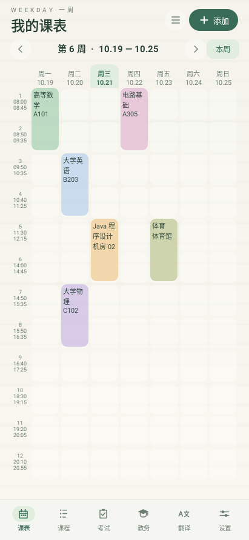

# 首版验收记录

## 自动检查

当前 1.3.12 测试包已移除“暮色湖畔”内置背景，运行时保留 10 款内置背景；该背景的旧 SVG 仅属于历史归档，不参与 APK。

本次 UI 构建执行命令：`tools/build-android.ps1`，包含 `assembleRelease`、`lintRelease` 和 `testDebugUnitTest`。结果：**BUILD SUCCESSFUL，Lint 0 错误、28 条建议，48 个单元测试通过**。APK 已复制到 `dist/weekday-release.apk`。版本为 `1.3.12`（versionCode 18）。

最终 release APK SHA-256：`98723B5391228DA02F89327A0A6199EBCFA805A8D3145EF2EF5C751DFF968165`；`apksigner` 验证 APK v2 签名通过。签名证书 SHA-256 指纹：`16d54522bcd94cd2431b728c8780ec86f01bc56ffa292e6046a5c2f5ecc83bab`。

课程文字更新：取消课程块固定行数和省略号限制，按列宽持续换行至块底部，保持课程块既有尺寸；字号在设置值基础上减小 1sp，最低 8sp。执行 `tools/build-android.ps1`，打包、Lint 和全部 46 个单元测试通过。尚未在手机上验证此次文字布局。

本次新增的显示模式、统一行高和课程块尺寸偏好已通过 Java 编译。Robolectric 单元测试执行成功：46 个测试全部通过；测试覆盖主机原生首页渲染、课表切换过渡容器和现有课程范围切换，不等同于真机触摸验收。

本次交互更新：课表横向拖动会跟随手指移动，目标周在离屏构建后与当前周一起进入过渡容器，避免重建主页面造成闪烁；动画进度由手指滑动距离实时控制，跟手并排模式直接按手指位移并排移动两周，滚筒模式增加纵向收缩和 Y 轴翻页，淡入淡出模式使用轻量透明度过渡。设置页可自由选择三种周次切换动画，切周提交阈值为 40dp，达到阈值后松手自动完成剩余动画，未达到阈值回弹；显示教师设置使用带阴影圆形滑块的椭圆槽开关，左侧关闭、右侧开启。手势监听同时覆盖横向课表容器、竖向滚动区域以及课程/考试块，课程位置可直接滑动切换且不影响点击、长按操作。课表区域支持双指缩放以及横向/纵向滚动，星期/日期栏固定在课程体上方，主页左上角和当前周栏保持固定，课程范围收纳到顶部菜单；课程显示模式与课程块大小合并到设置中的同一入口，滑块范围为 100%–200%，紧凑、完整对应不可修改的 100%、135% 静态值，选择模式后会直接同步对应滑块值。紧凑模式按屏幕可用高度和当前作息节数计算统一行高，保证当前节次在一屏内显示；课程块只显示课程名和地点，地点按列宽自动换行，教师可选显示，不显示上课时间。外观新增跟随系统主题、春日、夏日、秋色、冬霜和暮色湖畔背景，全部内置背景的静态记录见 `docs/backgrounds`。考试按日期落到对应星期列，按开始/结束时间映射到作息节次，非标准结束时间使用其所在节次的结束边界。考试块显示在课表上并可点击编辑。教务网站只导入课程，考试继续通过考试页手动维护；新增中英在线翻译页、网络状态检查、备用翻译服务和响应解析测试。底部导航补充六项本地矢量图标、当前页高亮胶囊和按钮水波纹反馈，翻译页调整了输入区、主次操作按钮和结果区层次。

| 测试集 | 通过 |
| --- | ---: |
| 日历、作息和临时调整 | 8 |
| CSV / XLSX 解析与模板回读 | 4 |
| 导入去重与冲突规划 | 2 |
| 湖北经济学院来源、周次/节次解析 | 4 |
| 课程/考试提醒规划与闹钟 | 7 |
| Room SQL、迁移、多课表、备份恢复、损坏备份拒绝 | 7 |
| 原生首页渲染、详情、导入目标选择、课表切换、联网设置及离线错误处理 | 4 |
| 翻译响应、失败后切换、限流错误、双重失败及 UTF-8 分段 | 8 |

Lint 建议主要涉及中文单语言文本、偏好设置的同步持久化、WebView 登录所需的 JavaScript、EXIF 接口、绘制分配及部分无障碍建议，未屏蔽这些提示。SDK / AGP 兼容性提示见 [README](../README.md)。

测试覆盖：开学所在周的周一、跨周递增、手动校准与恢复、单/双/指定周、非法周次、连续课块合并条件、取消/调课的单周影响、作息重叠校验、CSV 引号/跨行文本、XLSX 共享字符串/空白列/首工作表、模板回读、错误 XML、新建课表/当前课表导入去重，湖北经济学院来源校验和单双周/不连续节次解析；导入目标选择与多课表切换，课程提醒随调课/作息/校准变化、考试独立提醒、通知去重，翻译响应分段合并，以及 Room 数据库迁移、备份恢复和非法备份拒绝。

多课表回归使用实际 Room 数据库和原生界面：读取模拟教务返回结果后仅出现导入目标选择；取消不创建课表，新建导入后自动切换，首页下拉切回原课表后能看到原有课程和考试。追加与重复导入保持目标隔离，作息副本互不影响，空数据和非法数据不会留下空课表，多课表备份可恢复。该测试不连接真实登录后的教务页面。

2026-10-20 翻译连接排查：Google 翻译域名在本机请求中超时，改为 MyMemory 默认、Google 备用。用 Java HttpURLConnection 实际请求 MyMemory，`hello`（en → zh-CN）返回 HTTP 200 和“你好”，`你好`（zh-CN → en）返回 HTTP 200 和“Hello.”。这是本机网络检查，不能代表用户手机网络已验收。自动测试通过注入超时和限流响应验证备用路径，不依赖外部服务在线。应用声明 INTERNET 与 ACCESS_NETWORK_STATE；翻译页可进入系统网络面板及本应用信息页，系统不提供这两项普通权限的运行时申请弹窗。

## 设备验收

本机现有的 API 37 模拟器缺少硬件加速驱动；启动加速模式失败，软件模拟模式也未连接成功。因此，本记录尚不声明真机或模拟器界面验证通过。

已使用 Robolectric 的 Android 原生图形运行库在主机渲染 API 28 首页，检查了周日期、课块跨度、导航和课程详情入口。以下图片来自实际 XML / Android 原生控件布局，使用测试隔离数据库中的**示例课程**，不是手机截图；这些数据未打包到 APK。

安装后需要人工确认：

- 五天/七天表格在不同分辨率及大字体下的显示，点击、长按、左右滑动及拖动阈值回弹动画。
- 考试日期、时间段、考场在课表中的星期列和节次覆盖显示。
- 手机 Wi-Fi / 移动数据下的中英互译，以及手机厂商联网限制的设置入口。
- 课程编辑、保存后退出重开、跨周临时调整及重叠课程展开。
- 手机系统文件选择器中的 CSV / XLSX 导入、备份导出和跨设备恢复。
- 手机相册图片、横竖图、EXIF 方向、双指缩放、裁剪后的背景及浅/深色主题。
- 学校教务网站的登录、验证码、SSO 跳转和表格下载；已验证湖北经济学院登录页可访问。没有测试真实账号、验证码或登录后的个人课表，因此不能把自动读取宣称为真机联网验收；安装后需由用户登录并检查课表字段。

## 数据说明

课表没有预填个人数据，模板只有演示内容。数据库操作和文件操作在后台线程执行。无云同步、无注册或统计 SDK。系统云备份和系统设备迁移排除 App 数据；换机使用 App 的显式备份功能。
